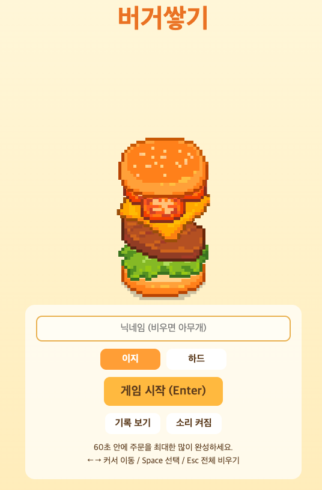
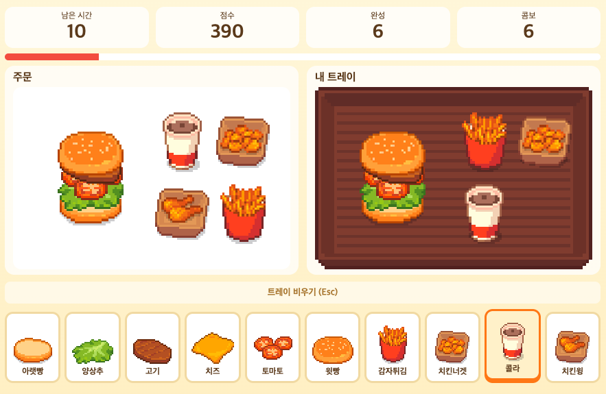

# 버거쌓기 (Stack Burger)

60초 안에 주문받은 햄버거와 사이드 메뉴를 최대한 많이 만드는 픽셀아트 웹 게임입니다.

## 게임 설명

- 화면 위쪽에 주문(햄버거 0~1개 + 사이드 0~4개)이 나타납니다.
- 아래 10칸에서 재료와 사이드를 골라 내 트레이에 똑같이 만들어 보세요.
- 주문과 똑같이 만들면 자동으로 다음 주문으로 넘어갑니다. 제출 버튼은 없습니다.
- 윗빵을 올리는 순간 햄버거를 비교합니다. 틀리면 햄버거만 비워지고(사이드는 유지) 감점은 없습니다.
- 첫 재료가 아랫빵이 아니거나 재료가 9개를 넘어도 햄버거가 바로 비워집니다. (최대 빵 2개 + 속재료 6개)
- 연속으로 실수 없이 완성하면 콤보 보너스 점수를 받습니다.

## 플레이 방법
1. 닉네임을 입력합니다. (비워두면 '아무개')
2. 모드(이지/하드)를 고르고 게임을 시작합니다.
3. 아래 칸 순서: 아랫빵, 양상추, 고기, 치즈, 토마토, 윗빵, 감자튀김, 치킨너겟, 콜라, 치킨윙
4. 사이드는 다시 선택하면 빠집니다. (같은 사이드는 1개만 담김)
5. 60초가 끝나면 결과 화면에서 점수와 순위를 확인합니다.

## 조작 키
| 동작 | 키 |
|---|---|
| 커서 이동 | ← → |
| 선택 | Space (칸을 마우스로 클릭해도 됨) |
| 트레이 전체 비우기 | Esc |
| 게임 시작 / 다시하기 | Enter |
| 결과, 기록 화면에서 메인으로 | Esc |

## 모드
| 모드 | 속재료 | 아래 10칸 위치 |
|---|---|---|
| 이지 | 1~3개 | 고정 |
| 하드 | 3~6개 | 새 주문마다 랜덤으로 섞임 |

## 점수
- 주문 1건: (속재료 수 + 사이드 수) x 10점
- 콤보 2부터 (콤보 - 1) x 10점 추가 (최대 50점)
- 기록은 브라우저에 저장되며 모드별 상위 10건이 남습니다.

## 실행 방법
- 설치나 빌드 없이 `index.html` 을 브라우저(Chrome 등)로 열면 바로 실행됩니다.
- 효과음은 브라우저에서 직접 만들어 재생하며, 메인 화면에서 끄고 켤 수 있습니다.
